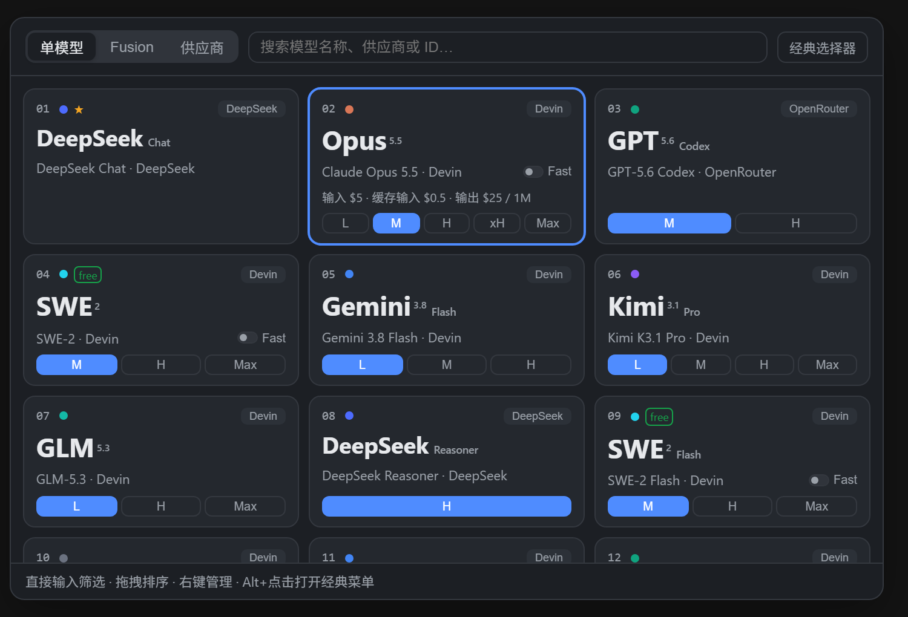
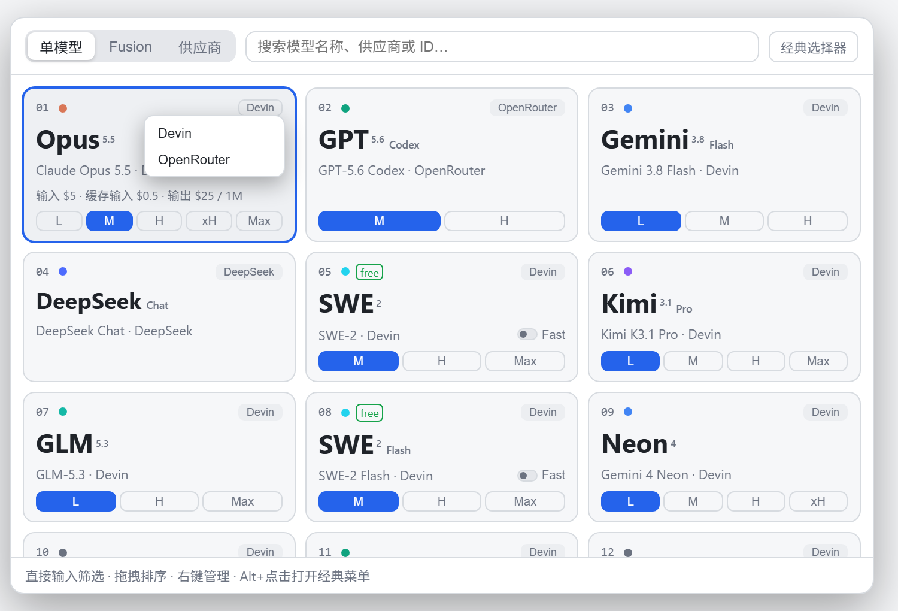
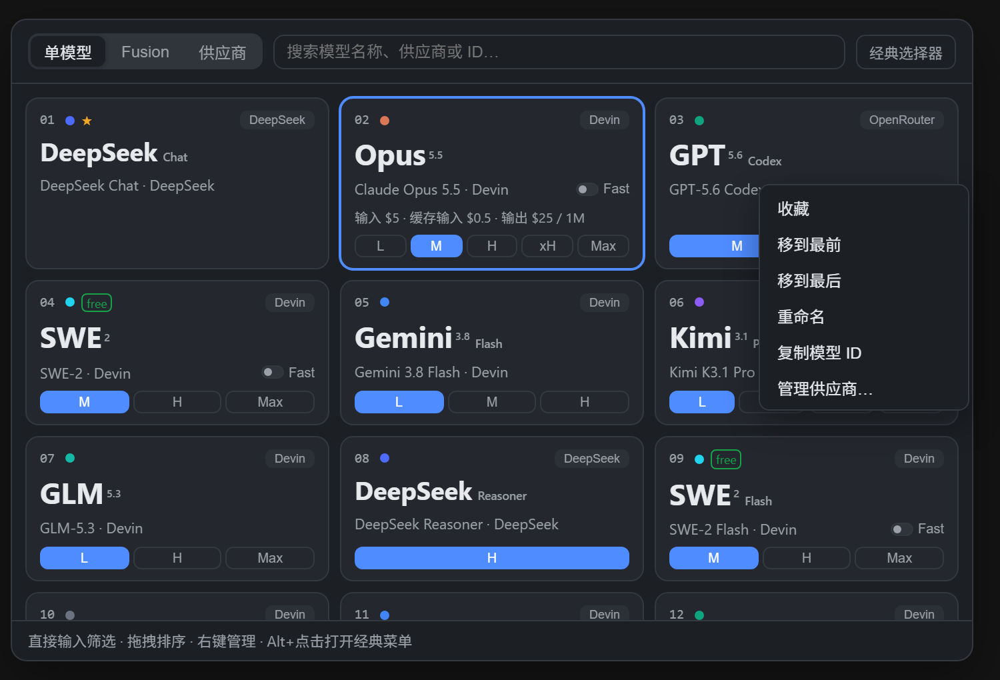
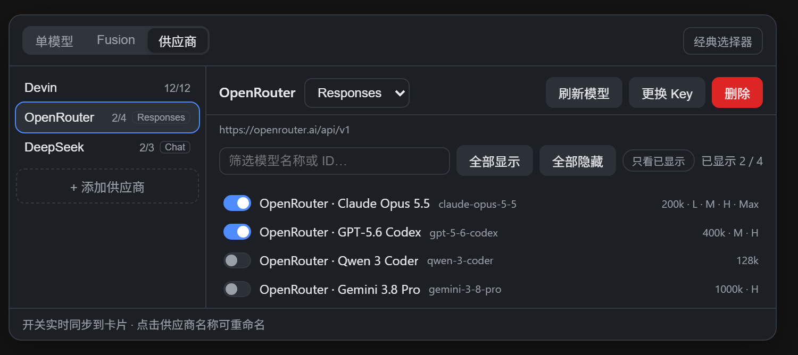
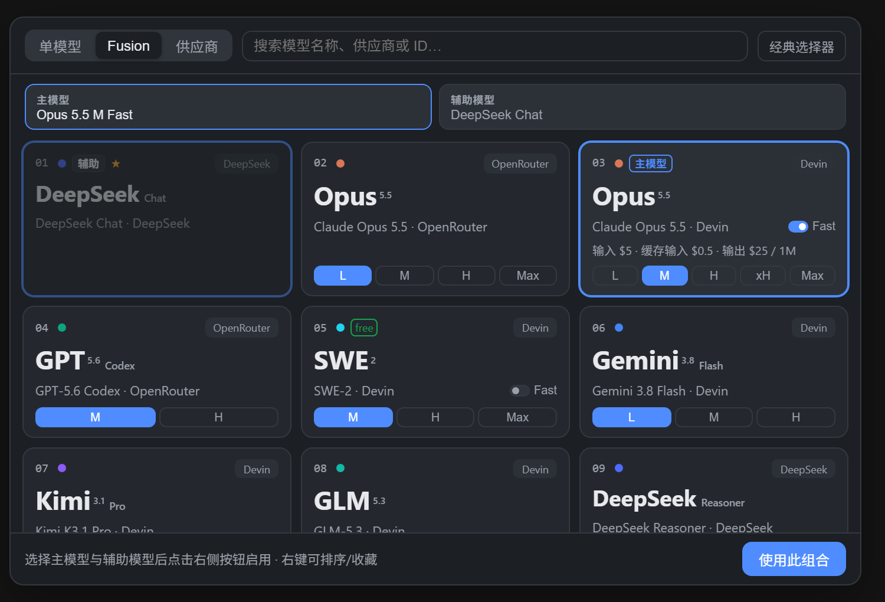

# Devin Model Picker

**English** | [简体中文](./README.zh-CN.md)

Bring your own OpenAI-compatible and Anthropic-compatible API models (**BYOK**) into **Devin Desktop**, choose models from a fast **visual card grid**, and freely pair **Lead + Sidekick** combinations in **Fusion** mode.



---

## Key Features

- **Visual Card Picker** — Replaces the long dropdown list with a clean, searchable card grid that matches your Devin light/dark theme. Switch reasoning effort (`Off` / `Min` / `L` / `M` / `H` / `xH` / `Max`) and toggles (`Fast`, `1M`, etc.) directly on each card.
- **Native Cost & Pricing Info** — Displays Devin's native pricing per 1M tokens, `free` badges, or credit multipliers where provided, while keeping BYOK cards clean.
- **Built-in BYOK Provider Manager** — Paste a Base URL and API Key right inside the **供应商** (Providers) tab to auto-detect OpenAI Chat Completions, OpenAI Responses, or Anthropic format and toggle individual models on or off in real time.
- **Custom Fusion Pairing (Lead + Sidekick)** — Mix and match any native Devin model or BYOK model across two customizable Fusion slots without being limited to preset pairs.
- **Personalize Your Grid** — Drag and drop cards to reorder or swap positions, pin favorites (`★`), rename cards with custom aliases, and jump straight to provider settings from the context menu.
- **Classic Picker Anytime** — Switch back to Devin's native dropdown menu with one click (`经典选择器`) or hold `Alt + Click` to open the native menu once without changing your default view.
- **Local-First & Auto-Updated** — Runs a local loopback proxy (`127.0.0.1:39852`) so API keys never leave your machine to third-party servers, and checks GitHub Releases every 6 hours for verified in-place `.vsix` updates.

---

## Installation

1. Download the latest `.vsix` package from [**GitHub Releases**](https://github.com/klarkxy/devin-model-picker/releases/latest).
2. Open **Devin Desktop**, open the **Extensions** panel (`Ctrl+Shift+X` / `Cmd+Shift+X`), click `...` → **Install from VSIX…**, and select the downloaded `.vsix` file.
3. After activation, a notification will prompt you to **Reload Window** (`重新加载`) so the card picker UI takes effect.

> [!NOTE]
> - To render the card picker inside Devin's chat composer, the extension adds a single `<script>` tag to Devin's `workbench.html` and updates `product.json` checksums. It automatically re-applies itself after Devin upgrades and removes all changes cleanly when disabled or uninstalled.
> - If Devin is installed in a system directory without write permissions, Devin Model Picker will notify you so you can grant write permission or run once with elevated permissions to apply the UI injection.
> - Installed extensions check GitHub Releases automatically every 6 hours; you can also check manually via the Command Palette (`Model Picker：检查更新`).

---

## Usage Guide

### 1. Single-Model Card Picker (`单模型`)

Click the model selector button in Devin's composer to open the card grid.

- **Filter & Quick Select**: Start typing immediately to search by model name, provider, or model ID; press `Enter` to select the top matching card, or `Esc` to clear the filter / close the panel.
- **Effort & Variant Toggles**: Click an effort pill (`L`, `M`, `H`, `xH`, `Max`, etc.) or toggle switch (`Fast`, `1M`, etc.) directly on a card to switch to that exact variant.
- **Multi-Provider Switching**: When both Devin and one or more BYOK providers offer the same model family (for example `Devin` and `OpenRouter` for `Claude Opus 5.5`), click the provider pill in the top-right corner of the card to switch between providers.



---

### 2. Organize Cards: Drag, Favorite & Rename

Right-click any card to open the context menu, or drag cards directly in the grid:



- **3-Zone Drag & Drop**: Drag a card over another card's **left edge** to insert before it, **right edge** to insert after it, or **center** (dashed outline) to swap the two cards in place.
- **Favorites (`收藏` / `取消收藏`)**: Starred cards (`★`) stay pinned to the front of the grid. Favorites reorder within the starred group, and non-favorites reorder within the remaining cards.
- **Rename (`重命名` / `恢复原名`)**: Give any model card a shorter or friendlier display alias (up to 40 characters) without affecting its underlying model ID.
- **Copy Model ID (`复制模型 ID`)**: Copies the exact active variant UID to your clipboard.
- **Manage Provider (`管理供应商…`)**: For BYOK cards, jumps directly to that provider's detail view in the **供应商** tab.

---

### 3. Add & Manage BYOK Providers (`供应商`)

Switch to the **供应商** (Providers) tab directly inside the picker—no need to leave your chat box:



1. Click **`+ 添加供应商`** (Add Provider) at the bottom of the left sidebar.
2. Enter your **API Address** (e.g. `https://api.openai.com` or `https://openrouter.ai/api/v1`) and **API Key**, then press `Enter` or click **连接** (Connect).
   - The extension automatically probes your endpoint to detect **OpenAI Chat**, **OpenAI Responses**, or **Anthropic** format and fetches the model list (enriched with context window & reasoning effort metadata from `models.dev`).
3. Toggle the switches next to the models you want to appear in your card grid. Use the search box and **全部显示 / 显示筛选结果**, **全部隐藏 / 隐藏筛选结果**, and **只看已显示** filters for large provider catalogs.
4. Click a provider's name at the top to rename it, use the format dropdown (`Responses` / `Chat` / `Anthropic`) to override the detected API format, or click **刷新模型**, **更换 Key**, or **删除**.
5. Select **Devin** in the left sidebar to hide or show built-in Devin models you rarely use—hidden Devin models are hidden in both Single-Model and Fusion views.

> [!TIP]
> **Standalone Settings Panel**: You can also click **`Model Picker`** on the bottom-right status bar or run **`Model Picker：设置`** from the Command Palette (`Ctrl+Shift+P` / `Cmd+Shift+P`) to inspect token limits, capabilities, and metadata sources in a full-tab table, or toggle BYOK routing globally.

---

### 4. Fusion Lead + Sidekick Pairing (`Fusion`)

Switch to the **Fusion** tab to build your own **Lead (`主模型`) + Sidekick (`辅助模型`)** pair from both Devin's native models and your enabled BYOK models:



1. Click the **主模型** (Lead) or **辅助模型** (Sidekick) slot header at the top to choose which slot you are filling.
2. Click any model card (and pick its effort level or `Fast` toggle). Selecting a Lead model automatically advances focus to the Sidekick slot if it is empty.
3. Lead and Sidekick cannot use the exact same underlying model (cards already assigned to the other slot are dimmed). Assigned cards display **`主模型`** or **`辅助`** badges in their top row.
4. Click **`使用此组合`** (Use This Pair) in the bottom-right corner to activate the combination.

> [!NOTE]
> Newly connected or newly enabled BYOK models are immediately available in new chat sessions; already-open CLI sessions may take up to ~60 seconds to reflect newly added model IDs due to Devin CLI's session option cache.

---

### 5. Switch Between Card Picker & Classic Menu

- **Switch to Classic View**: Click **`经典选择器`** in the top-right corner of the card panel to return persistently to Devin's native dropdown menu.
- **One-Shot Native Menu**: Hold **`Alt + Click`** on the composer model button to open Devin's native dropdown once without changing your default card view.
- **Switch Back to Cards**: Click the **`卡片`** button shown at the top of the native dropdown menu (or beside the model button while in classic mode) to return to the card picker.

---

## Commands

Open the Command Palette (`Ctrl+Shift+P` / `Cmd+Shift+P`) and search for:

| Command | Description |
| --- | --- |
| `Model Picker：设置` | Open the full settings panel (also accessible via the `Model Picker` status bar item). |
| `Model Picker：检查更新` | Check GitHub Releases now for a newer `.vsix` version. |
| `Model Picker：重新注入选择器` | Manually re-apply the workbench card picker injection if needed. |
| `Model Picker：停用并恢复` | Disable all proxy hooks, restore any modified Devin settings from the saved receipt, and remove the workbench injection. |

---

## Privacy, Security & Clean Removal

- **API Keys Stay Local**: Provider API keys are stored solely in Devin's local extension global storage (`config.json`) and are never returned to the picker UI, catalog payloads, or third-party endpoints.
- **Loopback Proxy Only**: Requests to BYOK models are routed through a local loopback service (`127.0.0.1:39852`) using your own credentials directly to your configured provider URLs.
- **Clean Restore on Disable / Uninstall**: Disabling via **`Model Picker：停用并恢复`**, disabling the extension in the Extensions panel, or uninstalling it restores your original `devin.acp.agentEnv` settings using a saved receipt and removes the injected `<script>` tag from `workbench.html`.
- **Legacy Extension Conflict**: If the older `Devin Fusion BYOK` extension (`local.devin-fusion-byok`) is still enabled, Devin Model Picker refuses to start to avoid port/hook conflicts—please disable the legacy extension and reload the window.

---

## Troubleshooting

<details>
<summary><strong>The card picker didn't appear after installing or updating Devin</strong></summary>

1. Reload the Devin window (`Developer: Reload Window`) after the *"选择器已更新，重新加载窗口后生效"* notification appears.
2. If Devin updated and overwrote `workbench.html`, run **`Model Picker：重新注入选择器`** from the Command Palette and reload the window.
3. If you see a write-permission error on `workbench.html` or `product.json`, ensure your user account has write access to Devin's installation directory.

</details>

<details>
<summary><strong>A newly enabled BYOK model isn't selectable in the current chat yet</strong></summary>

Devin CLI caches the model list per active chat session for roughly 60 seconds. Start a **new chat session** to use the new model right away, or wait briefly for the active session cache to refresh.

</details>

<details>
<summary><strong>Provider auto-detection picked the wrong API format</strong></summary>

Open the **供应商** tab, select the provider, and change the format dropdown next to its name between **Responses**, **Chat** (OpenAI Chat Completions), and **Anthropic**.

</details>

---

## Build from Source

Requires Node.js (with built-in `node:test`, zero runtime npm dependencies):

```bash
npm test          # Run unit test suite
npm run package   # Build devin-model-picker-<version>.vsix
```

- License: [MIT](./LICENSE)
- Third-party notices: [THIRD_PARTY_NOTICES.md](./THIRD_PARTY_NOTICES.md)
