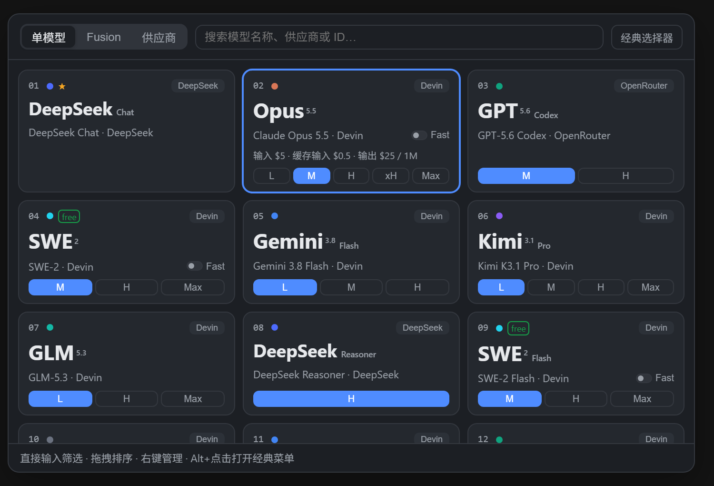
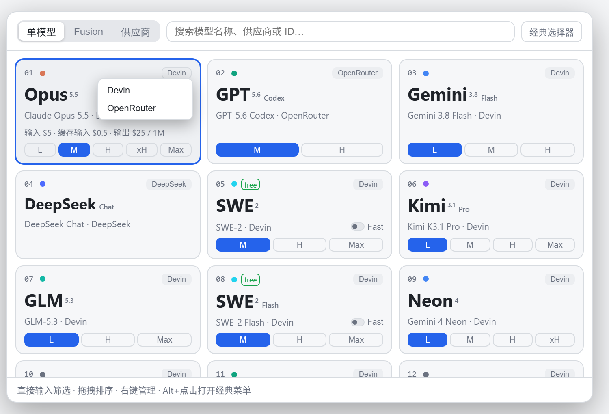
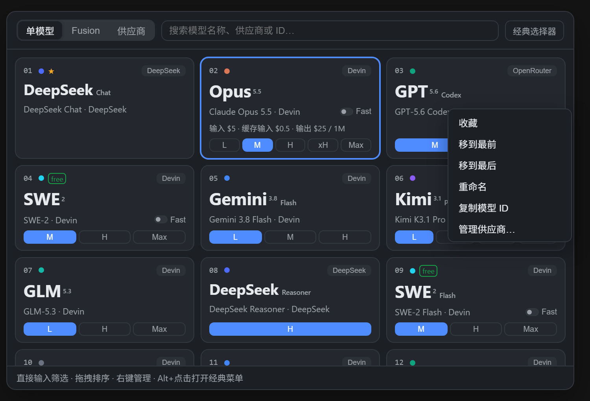
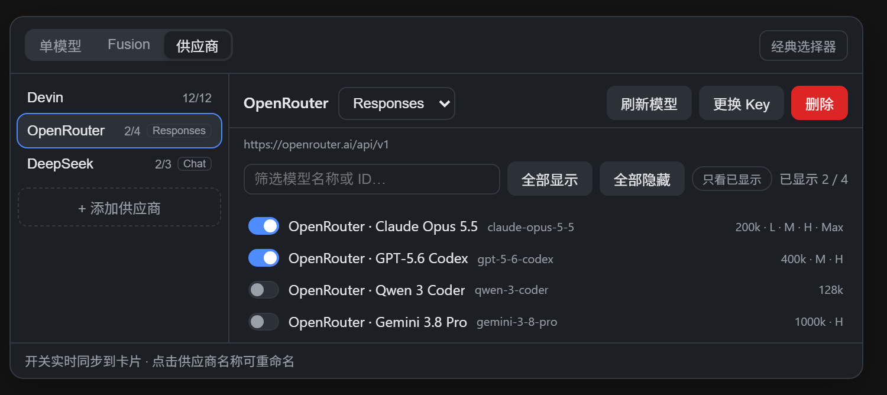
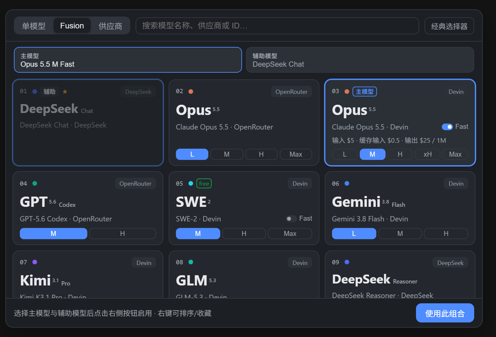

# Devin Model Picker

[English](./README.md) | **简体中文**

为 **Devin 桌面版** 接入自定义 OpenAI / Anthropic 兼容接口（**BYOK**），将冗长的下拉菜单升级为高效的**视觉卡片选择器**，并支持在 **Fusion** 模式中自由搭配 **主模型 + 辅助模型** 组合。



---

## 核心功能

- **视觉卡片选择器** — 将原生下拉列表替换为支持自动跟随 Devin 明暗主题的卡片网格。直接在卡片上切换推理强度（`Off` / `Min` / `L` / `M` / `H` / `xH` / `Max`）与特性开关（`Fast`、`1M` 等）。
- **原生计费与价格展示** — 针对 Devin 原生模型展示每百万 Token 价格、`free` 免费标记或点数倍率；BYOK 模型卡片保持简洁，不显示误导性的倍率标签。
- **内置 BYOK 供应商管理** — 直接在面板的**「供应商」**标签页填写 API 地址与 API Key，自动探测 OpenAI Chat / OpenAI Responses / Anthropic 接口格式并拉取模型列表，实时开关卡片显示。
- **自定义 Fusion 双模型组合** — 在**「主模型」**与**「辅助模型」**两个槽位中自由组合 Devin 原生模型与任意 BYOK 模型，不再局限于官方预设搭配。
- **个性化排版与管理** — 支持三区拖拽排序或互换位置、星标收藏置顶（`★`）、卡片重命名、一键复制模型 ID，以及右键直达供应商设置。
- **随时切回经典菜单** — 点击右上角**「经典选择器」**可随时切回 Devin 原生下拉菜单；按住 **`Alt + 点击`** 模型按钮可临时单次打开原生菜单。
- **本地运行与自动更新** — 通过本地回环服务（`127.0.0.1:39852`）代理请求，密钥仅保存在本地配置；每 6 小时自动检查 GitHub Releases，支持一键校验并原地升级 `.vsix`。

---

## 安装

1. 前往 [**GitHub Releases**](https://github.com/klarkxy/devin-model-picker/releases/latest) 下载最新的 `.vsix` 安装包。
2. 打开 **Devin 桌面版**，进入扩展面板（`Ctrl+Shift+X` / `Cmd+Shift+X`），点击右上角 `...` → **「从 VSIX 安装…」**，选择下载好的 `.vsix` 文件。
3. 安装激活后，按提示点击**「重新加载」**（Reload Window）使卡片选择器生效。

> [!NOTE]
> - 本扩展会向 Devin 的 `workbench.html` 注入一个 `<script>` 标签并更新 `product.json` 校验和，用于加载卡片选择器界面。每次扩展激活时会自动检查并自愈（Devin 客户端升级后无需手动重装）；停用或卸载扩展时会自动清理全部注入。
> - 若 Devin 安装在没有写权限的系统目录下，扩展会弹出权限提示，按提示授予安装目录写权限后重新加载即可。
> - 已安装的扩展每 6 小时自动检查 GitHub Releases 更新；也可在命令面板运行 `Model Picker：检查更新` 手动触发。

---

## 使用指南

### 1. 单模型卡片选择器（`单模型`）

点击输入框下方的模型按钮即可打开卡片面板：

- **输入即筛选 & 快捷键**：面板打开后搜索框自动获得焦点，直接输入即可按模型名称、供应商或模型 ID 筛选。按 `Esc` 先清空筛选、再关闭面板。点击卡片即可选中；焦点不在输入框时，按 `Enter` 选中首张匹配卡片。
- **推理档位与特性开关**：在卡片底部直接点击推理档位（`L`、`M`、`H`、`xH`、`Max` 等），或在副标题右侧切换 `Fast`、`1M` 等开关，立即切换到对应变体。
- **多供应商切换**：当同一个模型系列同时由 Devin 和多个 BYOK 供应商提供时（例如 `Claude Opus 5.5` 同时存在于 `Devin` 与 `OpenRouter`），点击卡片右上角的供应商标签即可在下拉菜单中切换来源。



---

### 2. 卡片整理：拖拽排序、收藏与重命名

右键点击任意卡片打开操作菜单，或直接在网格内拖拽卡片：



- **三区精准拖拽**：将卡片拖到目标卡片的**左侧边缘**可插入到其前面，拖到**右侧边缘**可插入到其后面，拖到**中心区域**（虚线框提示）可直接互换两张卡片的位置。
- **星标收藏（`收藏` / `取消收藏`）**：收藏的卡片会显示金色 **`★`** 并自动置顶。收藏组与普通组分别保持各自内部的排序顺序。
- **自定义别名（`重命名` / `恢复原名`）**：支持为任意模型设置最多 40 个字符的友好显示名称，不影响实际模型 ID。
- **复制模型 ID（`复制模型 ID`）**：复制当前选中档位对应变体的完整 UID，并在左下角显示复制提示。
- **管理供应商（`管理供应商…`）**：在 BYOK 卡片右键菜单中点击后，直接跳转到「供应商」标签页并定位到对应供应商。

---

### 3. 连接与管理 BYOK 供应商（`供应商`）

无需离开聊天界面，切换到面板顶部的**「供应商」**标签页即可完成全套配置：



1. 点击左侧栏底部的 **`+ 添加供应商`**。
2. 填写 **API 地址**（如 `https://api.openai.com` 或 `https://openrouter.ai/api/v1`）与 **API Key**，按 `Enter` 或点击**「连接」**。
   - 扩展会自动探测端点并识别 **OpenAI Chat**、**OpenAI Responses** 或 **Anthropic** 接口格式，拉取上游模型列表并合并 `models.dev` 的上下文长度与推理档位元数据。
3. 使用列表右侧的开关控制哪些模型显示在卡片网格中。模型较多时，可配合搜索框、**「全部显示 / 显示筛选结果」**、**「全部隐藏 / 隐藏筛选结果」**以及**「只看已显示」**快速筛选。
4. 点击供应商详情顶部的名称即可在线重命名；通过下拉框可手动覆盖接口类型（`Responses` / `Chat` / `Anthropic`）；也可随时点击**「刷新模型」**、**「更换 Key」**或**「删除」**。
5. 点击左侧栏的 **`Devin`** 可隐藏或恢复很少使用的内置原生模型；被隐藏的原生模型会在「单模型」与「Fusion」网格中同步隐藏。

> [!TIP]
> **独立设置面板**：你也可以点击编辑器右下角状态栏的 **`Model Picker`**，或在命令面板执行 **`Model Picker：设置`** 打开完整设置页面，以表格形式查看各模型的上下文窗口、最大输出、图片支持与元数据来源，或全局停用/启用 BYOK 接入。

---

### 4. Fusion 主/辅模型配对（`Fusion`）

切换到顶部的 **`Fusion`** 标签页，自由搭配**主模型（Lead）**与**辅助模型（Sidekick）**：



1. 点击顶部的**「主模型」**或**「辅助模型」**槽位卡片，切换当前要配置的槽位。
2. 点击下方任意卡片（可选定推理档位和 `Fast` 开关）填入对应槽位；填完主模型后，若辅助模型尚未选择，焦点会自动切换到辅助模型槽位。
3. 两个槽位不能选择同一底层模型（已被另一槽位占用的卡片会变灰禁用）。已填入槽位的卡片左上角会标注 **`主模型`** 或 **`辅助`** 徽章。
4. 当主模型为 Devin 原生模型时，辅助模型卡片会标注 **`官方`** / **`非官方`** 配对标签，非官方组合会在底部给出提示，但不会阻止或重排任何卡片。生效后，官方 Fusion 组合会在对话输入框的模型按钮上直接显示具体搭配（如 `Claude Opus 5.5 High + SWE-2 High`），而不再是笼统的 `Fusion`。
5. 配对完成后点击右下角的 **`使用此组合`** 即可生效。

> [!NOTE]
> 新连接或新启用的 BYOK 模型可在**新会话**中立即可用；由于 Devin CLI 会缓存已打开会话的模型选项列表，正在进行的旧会话最多可能需要约 60 秒才会同步显示新增模型 ID。

---

### 5. 在卡片选择器与经典菜单之间切换

- **切换到经典选择器**：点击面板右上角 **`经典选择器`**，即可持久切回 Devin 原生下拉菜单。
- **单次临时打开原生菜单**：在卡片模式下按住 **`Alt + 点击`** 输入框的模型按钮，可单次弹出 Devin 原生菜单而不改变默认模式。
- **切回卡片选择器**：在原生下拉菜单顶部（或经典模式下模型按钮旁）点击 **`卡片`** 按钮，即可切回卡片选择器并立即展开面板。

---

## 命令列表

打开命令面板（`Ctrl+Shift+P` / `Cmd+Shift+P`），可使用以下全部命令：

| 命令 | 说明 |
| --- | --- |
| `Model Picker：设置` | 打开独立设置面板（也可直接点击状态栏 `Model Picker`）。 |
| `Model Picker：检查更新` | 立即检查 GitHub Releases 是否有新版本 `.vsix` 可供安装。 |
| `Model Picker：重新注入选择器` | 手动重新应用 `workbench.html` 卡片选择器注入。 |
| `Model Picker：停用并恢复` | 关闭全部注入钩子、按保存的收据还原被修改的 Devin 设置，并移除界面注入。 |

---

## 隐私、安全与干净卸载

- **密钥仅留本地**：所有供应商的 API Key 仅存储在本地扩展数据目录的 `config.json` 中，不会上传至第三方服务器，也不会出现在任何选择器或网页端响应里。
- **本地回环代理**：BYOK 请求仅通过本地回环端口（`127.0.0.1:39852`）携带你的密钥直接转发到你配置的供应商接口。
- **干净停用与卸载**：无论运行 **`Model Picker：停用并恢复`**、在扩展管理器中停用扩展，还是直接卸载扩展，都会依据收据还原 `devin.acp.agentEnv` 原始配置并清除 `workbench.html` 注入。
- **旧版扩展兼容提示**：如果检测到旧版 `Devin Fusion BYOK`（`local.devin-fusion-byok`）仍在启用，本扩展会主动停止加载并提示先停用旧版，以免端口与注入冲突。

---

## 常见问题

<details>
<summary><strong>安装或 Devin 客户端升级后没有看到卡片选择器？</strong></summary>

1. 首次安装或看到「选择器已更新，重新加载窗口后生效」通知时，请点击**「重新加载」**。
2. 若 Devin 客户端更新覆盖了系统文件，请在命令面板运行 **`Model Picker：重新注入选择器`** 并重新加载窗口。
3. 若提示写权限不足，请检查当前用户对 Devin 安装目录的写入权限。

</details>

<details>
<summary><strong>刚启用的 BYOK 模型在当前对话列表里还没出现？</strong></summary>

Devin CLI 会对已打开的对话缓存约 60 秒的可用模型列表。新建一个对话即可立即看到新模型，或稍等片刻后刷新会话。

</details>

<details>
<summary><strong>Devin 官方发布新模型后会发生什么？</strong></summary>

扩展持续观测原生模型目录；发现前所未见的新模型时，会自动打开一个新会话——Devin CLI 只在新会话建立时刷新可用模型列表，此后新模型即可在新会话中直接选用。已经打开的旧会话保留创建时的模型列表快照，不会原地更新，这是 Devin 自身的设计。

</details>

<details>
<summary><strong>自动探测的接口类型不匹配怎么办？</strong></summary>

打开**「供应商」**标签页，选中对应供应商后，直接在名称旁边的下拉框中手动切换 **`Responses`**、**`Chat`** 或 **`Anthropic`** 即可。

</details>

---

## 从源码构建

需要 Node.js（内置 `node:test`，零第三方 npm 运行时依赖）：

```bash
npm test          # 运行全部单元测试
npm run package   # 打包产出 devin-model-picker-<version>.vsix
```

- 开源协议：[MIT](./LICENSE)
- 第三方声明：[THIRD_PARTY_NOTICES.md](./THIRD_PARTY_NOTICES.md)
